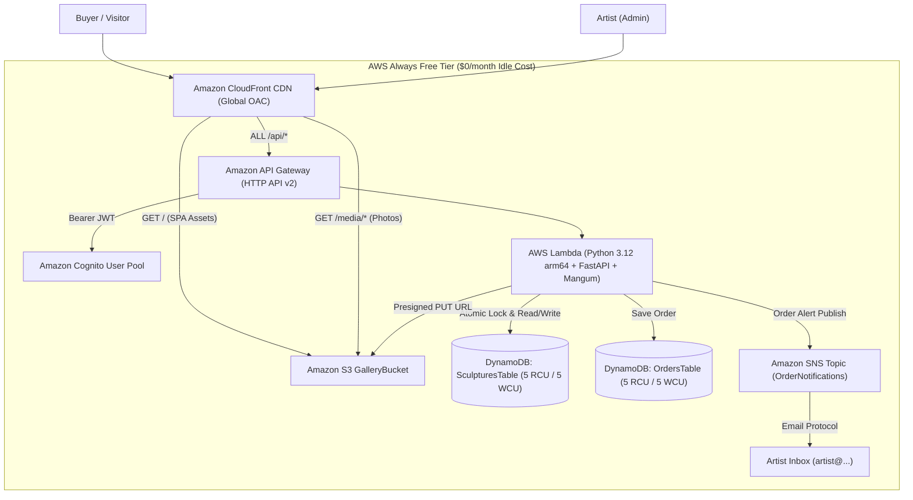

# Галерея Наївного Мистецтва (Naive Art Sculpture Gallery)
### Production-Ready Serverless Web Application & Storefront (AWS Free Tier Optimized: $0/month idle cost)

[](https://github.com/example/naive-sculpture-gallery/actions/workflows/deploy.yml)
[](https://aws.amazon.com/free/)
[](https://fastapi.tiangolo.com/)
[](https://react.dev/)

An online gallery and storefront designed for showcasing and selling original handcrafted sculptures in the **Naive Art (Наївне мистецтво)** style. Employs a **"Light Museum Minimalism"** aesthetic that acts as a quiet, white-cube gallery space letting tactile ceramic forms, coarse chamotte textures, and folk characters command 100% of the visitor's attention.

---

## 🏛️ 1. Aesthetic & UI/UX Principles ("Light Museum Minimalism")

- **Quiet Color Palette:**
  - `Primary Background:` Warm Milk / Alabaster (`#FAF8F5`)
  - `Card Surface / Accents:` Soft Gallery Stone (`#F3EFEA`)
  - `Primary Text:` Deep Charcoal Ink (`#18181B`)
  - `Secondary Text & Physical Specs:` Muted Warm Grey (`#71717A`)
  - `Subtle Status Badges:` Earth Green for `Available` (`#2E5A36`), Warm Ochre for `Reserved` (`#B47820`), Muted Terracotta/Grey for `Sold` (`#786F6D`).
- **Typography:**
  - Headings & Sculpture Titles: Editorial Serif (*Cormorant Garamond* with full Cyrillic support).
  - Body & Physical Specs: Clean geometric Sans-Serif (*Plus Jakarta Sans* / *Inter*) with tabular numerals (`tabular-nums`) for exact dimensions ($H \times W \times D\text{ cm}$) and prices.
- **Media Focus (2D High-Res Photography Only):**
  - No bloated 3D models.
  - Multi-angle high-resolution photography with full-screen Lightbox zoom to inspect clay grains, sgraffito lines, and glaze nuances.
  - Client-side WebP compression (HTML5 Canvas) before upload.
- **Bilingual (UA / EN):** Built-in lightweight dictionary switcher with Ukrainian `UA` as default.

---

## 🏗️ 2. AWS Serverless Architecture & Free Tier Verification

The entire infrastructure runs serverless without NAT Gateways, EC2 instances, paid VPC endpoints, or external paid SaaS:



### AWS Always Free Tier Limits vs. Gallery Usage

| AWS Component | AWS Free Tier Allocation | Gallery Architecture Configuration | Idle Monthly Cost |
| :--- | :--- | :--- | :--- |
| **Amazon DynamoDB** | 25 RCU / 25 WCU + 25 GB Storage | Provisioned: 5 RCU / 5 WCU per table (2 tables = 10 RCU/WCU total) | **$0.00** |
| **AWS Lambda** | 1,000,000 requests/mo + 3.2M sec (arm64) | FastAPI + Mangum on arm64 (outside VPC, 0 latency) | **$0.00** |
| **Amazon S3** | 5 GB Storage + 20,000 GETs / 2,000 PUTs | Compressed WebP storage + direct client PUT via Presigned URLs | **$0.00** |
| **Amazon CloudFront** | 1 TB Data Transfer Out/mo + 10M requests | S3 origin (OAC) + HTTP API proxy + 1-year immutable caching | **$0.00** |
| **Amazon Cognito** | 50,000 Monthly Active Users (MAUs) | Artist-only admin pool (1–5 users) | **$0.00** |
| **Amazon SNS** | 1,000 Email notifications/month | Order & inquiry email dispatch to artist | **$0.00** |
| **Amazon CloudWatch** | 5 GB Log ingestion + 10 metrics | 7-day log retention configured on all Lambda LogGroups | **$0.00** |

---

## 💳 3. Direct-to-Card Reservation & Coordination Flow

Rather than routing through an expensive payment gateway or foreign merchant processor:
1. **Acquisition Modal:** Buyer selects "Придбати / Забронювати", enters name, selects preferred communication channel (**Telegram** `@username` / phone vs. **Email**), and enters delivery details.
2. **Atomic Status Update:** `POST /api/orders` uses a DynamoDB condition expression (`status = AVAILABLE`) to atomically set status to `RESERVED` and saves the order record in `OrdersTable`. If another buyer booked it concurrently, a `409 Conflict` is returned.
3. **Instant SNS Email Alert:** Lambda publishes a formatted notification to the artist's SNS Topic with:
   - Unique Reservation Code (e.g., `NSG-8742`)
   - Buyer contact details
   - 1-click link to open personal chat in Telegram (`https://t.me/<username>`) or pre-addressed email
4. **Order Status Workflow in Admin:**
   - **Mark as Paid (Картку оплачено):** Sets order to `PAID` and automatically marks sculpture as `SOLD`.
   - **Mark as Shipped (Відправлено):** Sets order to `SHIPPED`.
   - **Cancel Reservation (Скасувати бронь):** Sets order to `CANCELLED` and returns sculpture to `AVAILABLE`.

---

## 📁 4. Project Monorepo Structure

```
naive-sculpture-gallery/
├── infra/
│   ├── template.yaml               # Complete AWS SAM template (Free Tier resources)
│   └── samconfig.toml.example      # Sample SAM deployment configuration
├── backend/
│   ├── app/
│   │   ├── main.py                 # FastAPI app + Mangum handler + API Gateway routes
│   │   ├── config.py               # Env configuration & AWS settings
│   │   ├── models.py               # Pydantic v2 schemas (multilingual UA/EN)
│   │   ├── db.py                   # DynamoDB repository & atomic conditional updates
│   │   ├── s3.py                   # Presigned URL generator with MIME type validation
│   │   ├── notifications.py        # Amazon SNS notification publisher
│   │   ├── auth.py                 # Cognito JWT token verification dependency
│   │   └── seed_data.py            # Initial seed sculptures with rich folklore context
│   ├── tests/
│   │   └── test_api.py             # 12 automated pytest tests (atomic locks, spam, etc.)
│   ├── requirements.txt            # Python dependencies
│   └── run_local.py                # Local server runner on port 8000
├── frontend/
│   ├── src/
│   │   ├── components/             # Reusable museum UI components
│   │   │   ├── layout/             # Header, Footer
│   │   │   ├── gallery/            # SculptureCard, SculptureGrid, FilterBar, Lightbox
│   │   │   ├── order/              # AcquisitionModal (direct-to-card reservation)
│   │   │   └── common/             # StatusBadge, Button, ImageWithFallback
│   │   ├── pages/                  # Route views (Home, Detail, Archive, About, Contact)
│   │   │   └── admin/              # AdminLoginPage, AdminDashboardPage, MultiPhotoUploader
│   │   ├── services/               # api.ts, auth.ts, imageOptimizer.ts, mockData.ts
│   │   ├── context/                # LanguageContext (UA/EN), AuthContext
│   │   └── types/                  # TypeScript data interfaces
│   ├── tailwind.config.js          # "Light Museum" color palette & typography
│   ├── vite.config.ts              # Vite configuration with API proxying
│   └── package.json
├── .github/workflows/
│   └── deploy.yml                  # Automated GitHub Actions CI/CD pipeline
├── Makefile                        # One-command build, test, and deploy targets
└── README.md
```

---

## 🚀 5. Quickstart & Local Development

### Prerequisites
- Python 3.12+
- Node.js 20+ & npm

### 1. Clone & Install Dependencies
```bash
git clone <repo-url> naive-sculpture-gallery
cd naive-sculpture-gallery
make install
```

### 2. Run Backend Unit Tests
```bash
make test
```
*Executes all 12 test scenarios: atomic reservation conflict checks, honeypot spam protection, admin order transitions, and upload URL validation.*

### 3. Start Local Development
```bash
make dev
```
- **Frontend:** [http://localhost:5173](http://localhost:5173)
- **Backend API Docs (Swagger):** [http://localhost:8000/api/docs](http://localhost:8000/api/docs)
- **Admin Login:** Visit `/admin/login` (enter any password $\ge 6$ chars in local mode).

---

## ☁️ 6. Production Deployment to AWS

### 1. Configure AWS CLI & SAM CLI
```bash
aws configure
sam --version
```

### 2. Deploy Infrastructure & Frontend with One Command
```bash
make deploy STACK_NAME=naive-sculpture-gallery AWS_REGION=eu-central-1 ARTIST_EMAIL=artist@your-domain.com
```

### 3. Create the Artist Admin User in Cognito
After deployment completes, create the artist account:
```bash
# Retrieve User Pool ID from CloudFormation
USER_POOL_ID=$(aws cloudformation describe-stacks \
  --stack-name naive-sculpture-gallery \
  --query "Stacks[0].Outputs[?OutputKey=='CognitoUserPoolId'].OutputValue" \
  --output text)

# Create admin user
aws cognito-idp admin-create-user \
  --user-pool-id $USER_POOL_ID \
  --username artist@your-domain.com \
  --user-attributes Name=email,Value=artist@your-domain.com Name=email_verified,Value=true \
  --message-action SUPPRESS

# Set permanent password
aws cognito-idp admin-set-user-password \
  --user-pool-id $USER_POOL_ID \
  --username artist@your-domain.com \
  --password "YourSecurePassword123!" \
  --permanent
```

### 4. Confirm Amazon SNS Email Subscription
Check the artist's inbox for an email from **AWS Notifications** with the subject *"AWS Notification - Subscription Confirmation"* and click **Confirm subscription**. All future order and inquiry alerts will arrive in plain text immediately.

---

## 🔒 7. Cost & Security Guardrails

1. **CloudWatch Logs:** Strict 7-day retention set via `RetentionInDays: 7` on all Lambda LogGroups.
2. **Spam & Lockout Prevention:** Hidden honeypot field (`website_hp`) and IP sliding-window rate limiting on `POST /api/orders` prevent bot reservation lockouts.
3. **MIME Type Enforcement:** Presigned URL endpoint strictly allows only `image/webp`, `image/jpeg`, and `image/png`.
4. **VPC-Free Architecture:** Lambda functions execute outside VPCs, eliminating expensive AWS NAT Gateway fees ($32+/month).

---

## 📄 License
MIT License. Handcrafted with sincerity for Ukrainian Naive Art.
